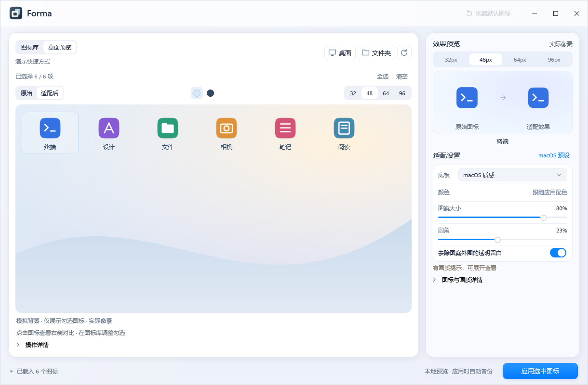
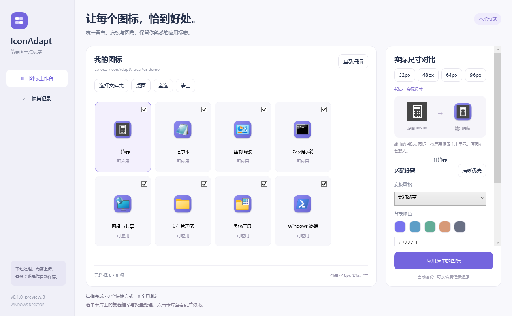
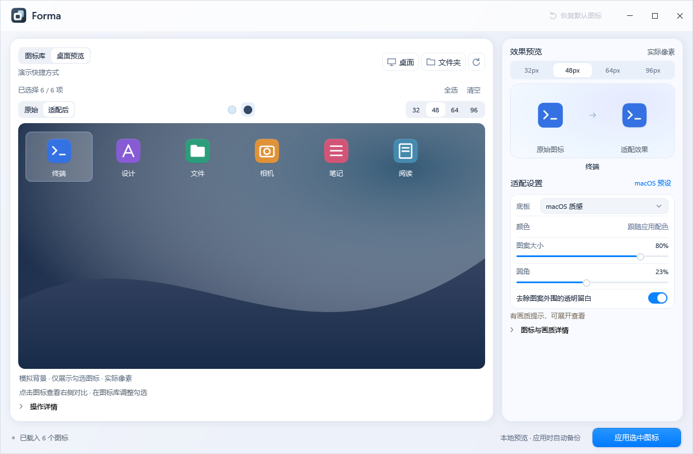

<p align="center">
  
</p>

# Forma

**A more coherent Windows desktop.** A native app that balances icon size, padding and backgrounds while keeping applications recognizable.

[简体中文](README.md) · **English**

[](https://github.com/BOCINPITY/Forma/actions/workflows/build.yml)
[](LICENSE)


[Download](https://github.com/BOCINPITY/Forma/releases) · [User guide](docs/en/user-guide.md) · [Development](docs/en/development.md) · [中文使用说明](docs/user-guide.md)



## Features

- **Compare a whole set.** Light and dark backgrounds, original/adapted views, and 32 / 48 / 64 / 96px previews at physical pixel size.
- **Adapt by shape.** The macOS material treats existing plates, circles, transparent marks and fine or complex artwork differently, with bounded optical sizing and safe margins. Gradient, solid and transparent modes are also available.
- **Keep native detail.** Read original icon frames, generate each ICO size directly, and preview actual exported frames without repeated resizing.
- **Apply in batches, restore in one step.** Back up before writing, preserve launch properties, and unwind multiple adaptation layers automatically.
- **Native and local.** C# / .NET 10 / WPF, a macOS-inspired interface and short transitions. The app mark is drawn entirely in code. No model service is required.

| Library and pixel comparison | Dark desktop preview |
| --- | --- |
|  |  |

Screenshots use original synthetic artwork and demo states. The interface currently uses Chinese labels. The scene simulates a background and arrangement; it does not read your wallpaper or move desktop icons. Window surfaces are drawn in WPF.

## Download and use

1. Download `Forma-<version>-win-x64.zip` from [Releases](https://github.com/BOCINPITY/Forma/releases), **extract the entire archive**, and run `Forma.exe`. No separate .NET installation is needed.
2. Scan the desktop or choose a shortcut folder. Check the icons you want to change, then select **macOS 预设** (macOS preset) or adjust the style.
3. Review the set in **桌面预览** (desktop preview), inspect individual icons at 32 / 48px, then select **应用选中图标** (apply selected icons).
4. Select **恢复默认图标** (restore default icons) to return to the references saved before Forma's first change, including any custom icons you already had.

Current version: **`0.1.0-preview.9`**, Windows x64, primarily tested on Windows 11. This is an unsigned development preview without an installer or automatic updater. Close the old version before starting a newer one.

**Keep `%LOCALAPPDATA%\IconAdapt\` after applying icons.** It stores persistent ICO files, backups and operation records. Shortcuts continue to reference those ICO files. Restore icons before deleting app data. Forma was previously named IconAdapt and retains its data directory for compatibility.

Supported inputs are ordinary `.lnk` application shortcuts on the desktop or in a selected folder, currently pointing to accessible `.exe` files. Scans are not recursive. Taskbar icons, Start menu entries, file associations, special Shell icons and dedicated Store app entries are outside the current scope. Permission failures are reported per item; Forma does not elevate itself, restart Explorer or clear the global icon cache. Low-resolution sources cannot regain missing detail. See the [user guide](docs/en/user-guide.md) and [quality notes](docs/en/icon-quality.md).

## Build from source

Requires Windows x64, Git and .NET 10 SDK. All scripts use PowerShell.

```powershell
git clone https://github.com/BOCINPITY/Forma.git
Set-Location .\Forma
# Optional: download and verify a project-local SDK without changing PATH
powershell -NoProfile -ExecutionPolicy Bypass -File .\scripts\bootstrap.ps1
powershell -NoProfile -ExecutionPolicy Bypass -File .\scripts\check.ps1
powershell -NoProfile -ExecutionPolicy Bypass -File .\scripts\run.ps1
```

Create a self-contained portable archive with bilingual user guides and license notices:

```powershell
powershell -NoProfile -ExecutionPolicy Bypass -File .\scripts\publish.ps1 -Zip
```

Output: `artifacts\Forma-<version>-win-x64\`, plus a ZIP and `.sha256` checksum. SDK files, build output and local test data are excluded from Git.

## Automated builds and releases

- [Build](.github/workflows/build.yml) runs on `main` pushes, pull requests and manual dispatch, validates the project and uploads the portable package as an Actions artifact.
- [Release](.github/workflows/release.yml) builds a pushed `v<version>` tag, or an existing tag selected manually, and uploads a GitHub Release. The tag must match `Directory.Build.props`.
- Versions with a prerelease suffix, including `preview`, are marked **Pre-release**. Packages currently target Windows x64 and include a SHA-256 checksum.

See the [release guide](docs/releases.md#english). Check the repository's Actions page for actual run results; a successful build does not prove every real desktop scenario has been verified.

## Documentation and contributions

| English | 中文 |
| --- | --- |
| [Documentation index](docs/en/README.md) | [文档导航](docs/README.md) |
| [User guide](docs/en/user-guide.md) | [使用说明](docs/user-guide.md) |
| [Development](docs/en/development.md) | [开发指南](docs/development.md) |
| [Architecture](docs/en/architecture.md) | [技术架构](docs/architecture.md) |
| [Icon quality](docs/en/icon-quality.md) | [清晰度与形态适配](docs/icon-quality.md) |
| [Release guide](docs/releases.md#english) | [发布说明](docs/releases.md) |

Chinese documents also cover [UI design and motion](docs/ui-design.md), [the code-drawn brand](docs/brand.md), [historical verification](docs/verification.md), [the roadmap](docs/roadmap.md) and [the changelog](CHANGELOG.md). Reports and pull requests are welcome; read [Contributing](CONTRIBUTING.md#english) before submitting changes.

## License

Forma's source and original assets are licensed under the [MIT License](LICENSE). Dependencies retain their own licenses and notices; see [THIRD-PARTY-NOTICES](THIRD-PARTY-NOTICES.md) and [licenses](licenses/README.md). Forma does not distribute Apple icons or third-party application icon packs. Icons extracted from a user's installed apps remain the property of their respective rights holders.
