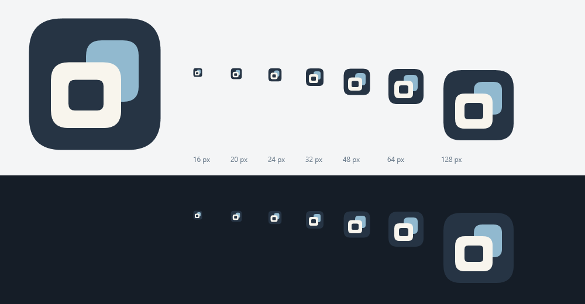

# Forma：品牌、字体与代码图标

## 名称

Forma 取“形态”的含义，表达把不同应用图标整理成协调外观。名称用于窗口、提示框、可执行文件属性和便携包。原 IconAdapt 的源码模块名与数据目录继续沿用，以保持现有备份、图标引用和恢复记录可用。

## 字体

界面使用 Windows 已安装的系统字体，不下载或捆绑字体文件。西文字体优先使用 Segoe UI Variable Text，中文回退到 Microsoft YaHei UI；旧系统可回退到 Segoe UI。

正文与常规按钮以 13px 为主，设置标签、图标名称和辅助文字以 12px 为主；标题靠字号、留白和少量字重区分，不把全部中文标题加成粗黑体。颜色输入使用等宽字体，窗口操作按钮使用系统符号字体。图标名称与长诊断分别检查中英混排、截断和换行。

图标预览仍按物理像素显示；字体尺寸属于 WPF 的独立像素，两者不混用。增加字号后仍须保留紧凑窗口内的预览、基础设置与应用入口。

## 图标制作约束

应用标志完全由代码中的几何形状、路径和颜色定义。界面矢量标志、SVG 与各尺寸 ICO 来自同一组几何数据。禁止生成式图片、下载图标、Apple 素材或字体字形拼装标志。

标志由深墨色圆角底、冰蓝后形与象牙白前框组成，表达不同形态进入同一轮廓。四条路径保存在构建脚本中，脚本同时生成 `BrandMark.cs`、SVG 与 ICO；修改时只编辑脚本中的原始路径。



执行以下命令重新生成图标：

```powershell
powershell -NoProfile -ExecutionPolicy Bypass -File .\scripts\build-icon.ps1
```

需要 Windows 的 WPF 绘图环境。生成过程逐尺寸绘制，不从某一张低分辨率图放大；对小尺寸检查主轮廓和负空间，对透明边缘检查抗锯齿。资产文件保留技术名称 `Assets\IconAdapt.ico` 和 `Assets\IconAdapt.svg`，不影响 Forma 产品名。

## 验收

实际窗口检查中文、英文、数字、长应用名和诊断文字；在 960 × 680、1046 × 794 和默认窗口检查基础操作没有裁切。图标分别检查 16 / 20 / 24 / 32 / 48 / 64 / 128 / 256px，以及标题栏内的矢量绘制。布局断言用于发现裁切，最终观感仍通过截图目视判断。
