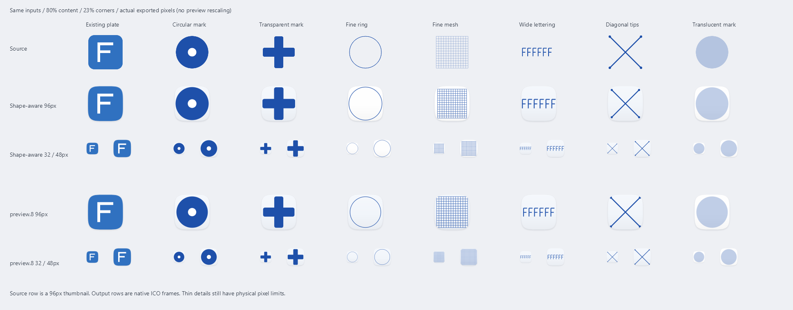
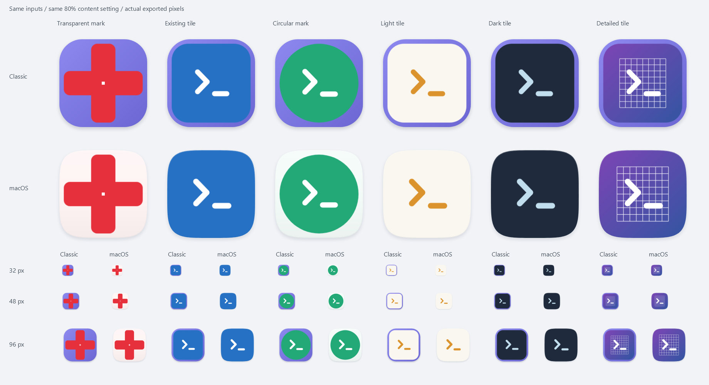

# 清晰度设计与验收

## 设计原则

适配首先应保留应用的识别度和细节，再统一外观。能够生成 ICO、应用和恢复，并不代表视觉质量合格。验收必须查看实际显示尺寸，不能只看 256px 放大预览。

## preview.9：按形态适配

macOS 质感进一步以 Alpha 面积覆盖、轮廓与边缘变化区分已有底板、实心圆形标志、透明标志和细线 / 复杂图案。分类只依据像素，不识别应用名称或设计语义；半透明和不确定图案采用保守路径。

- 已有底板保留原有配色并融合外轮廓，避免多套一层明显小方框。
- 圆形标志与透明标志采用有上限的光学大小补偿；细线 / 复杂图案适度增加有效绘制跨度，尽量保留小尺寸下可用像素。
- 非底板图案按可见轮廓及目标圆角约束安全留白，避免对角尖端被过大的比例切掉。各原生帧分别检查安全范围，所选帧的跨度同时用于选帧和实际绘制。
- 关闭“去除图案外围的透明留白”时尊重完整画布，不主动消除用户保留的留白。不添加锐化、描边或二次缩放；其他三种模式保留原渲染行为。

这仍是通用规则，无法代替逐应用的专属设计，也不能把低清原图变成高清。细线、密集纹理和被安全区限制的图案会提供提示，用户应在桌面整体预览和 32 / 48px 对比中共同检查。

下图使用八种代码绘制样本、相同 80% 比例和 23% 圆角，对比 preview.8 与新规则；输出行直接使用 96 / 32 / 48px ICO 帧，来源行仅为缩略图。圆形 / 细线的跨度调整较小，密集网格与对角尖端优先保留安全留白，不以放大一切作为画质改进。

## preview.6：macOS 质感模式

新增模式保留原有渐变 / 纯色 / 无底板模式的渲染行为。新模式分析原图的可见轮廓、透明覆盖率、边缘覆盖与配色，保守区分完整底板与透明标志。

- 完整底板填满新的连续圆角轮廓，底色由原图边缘估计，减少嵌套小方块和宽色框。
- 透明标志使用从原图取色的浅色材质，保持原始前景颜色与清晰细节。
- 使用连续变化的超椭圆外轮廓、柔和纵向光照、内缘高光和独立阴影。小尺寸省略细高光，保持主形清楚。
- 有底板时的有效显示跨度参与原生帧选择，避免源帧选得过小再放大；前景继续用原有预乘 Alpha 面积缩放。内容先合成，再按外轮廓裁切一次。

“macOS 预设”是主动操作。新安装默认启用新模式；旧设置文件按原样读取。模式枚举在原有值后追加，不改写旧风格含义。

底板识别是保守规则，不会理解所有应用的设计意图。异形底板、半透明图形或照片式图标可能需要手动选择其他模式；此功能不重画源标志、不恢复源图缺失的细节，也不修改真实桌面直至用户应用。

下图使用同一组合成输入与相同 80% 设置，对比旧渐变模式和新材质模式；底部为实际导出的 32 / 48 / 96px，不把大图缩放截图当作小尺寸输出。

## 旧版问题

1. 将原图直接用固定范围插值缩到很小的图案，未按缩小倍率充分低通采样，细线、小字和重复纹理会混叠或断裂。
2. 仅取一张 256px 图片，丢掉源应用为小尺寸手工优化的原生帧。请求得到 256px 也不能证明源资源真的有这么高的分辨率。
3. 生成帧不够完整，部分常用显示尺寸需要再次缩放。
4. 图案占比较低且保留原画布留白时，可用的图案像素进一步减少。滤镜无法恢复已经被挤掉的细节。
5. 界面使用固定 DIP 大小缩放一张大预览图，多次插值及 DPI 变化后与实际输出不一致。

## preview.3 的处理

### 原图

直接读取所选 ICO / EXE 图标组中的原生 PNG 或 DIB。PNG 字节保留原样，DIB 按原生尺寸解码；同时保留不同尺寸的最佳帧，不预先放大低清资源。尺寸以图像实际内容为准，不信任 ICO 目录的尺寸标签。

最大帧供大图输出，小帧按需要优先采用。原生帧按实际可见跨度选择，避免含大量透明边的 32px 画布被当作 32px 图案。资源数、总字节和解码像素有上限，坏帧跳过并提示。

### 缩放与轮廓

缩小时对整个目标像素覆盖范围进行预乘 Alpha 面积积分，避免跳采样、色边和负权振铃；原生 1:1 对齐像素保持，放大只作正常线性插值，不伪造细节。保留非零透明边缘，取消极细图案强行拉宽。

输出尺寸为 16 / 20 / 24 / 32 / 40 / 48 / 64 / 80 / 96 / 128 / 192 / 256px。所有小帧从合适的原生源生成，不从已经合成的大预览反复缩小。

使用底板时，前景和底板先组成完整内容层，再按同一圆角轮廓抗锯齿裁切一次；阴影单独绘制，防止方形底图露出圆角或重复乘边缘覆盖率。比例过大时图案可能被轮廓裁切，可降低比例留住边缘；透明背景模式保留原轮廓。

### 预览和预设

- 检查器直接选取导出 ICO 的 32 / 48 / 64 / 96px 帧；切换仅显示已有帧，不触发重新渲染。
- 列表显示 48 个物理像素，按设备像素对齐。原图选择匹配的原生帧，不能把小原图虚放大来冒充清晰源图。
- “清晰优先”由用户主动点击，设置去除透明留白和 80% 图案占比；升级保留已有设置。
- 小源图、低图案占比和高比例裁切等限制如实显示，不把正常灰色抗锯齿边缘称作可恢复的高清细节。

## 验证

- 条纹、细斜线、低 Alpha 边缘、原生像素小字、原生小帧选择及圆角合成的自动回归。
- WIC 解码 12 种输出尺寸，256px 预览与对应 ICO 帧相同。
- WPF 离屏渲染逐像素验证 48px 预览与导出帧一致，小原图不放大，切换尺寸不重跑渲染，已有设置不被静默覆盖。
- 对 100 / 125 / 150 / 200% DPI 进行几何计算测试，验证物理尺寸和奇数尺寸居中时的像素对齐。这不是多屏 DPI 切换实机验证。
- 使用本机应用图标只读提取、生成同设置前后对照，再单独展示清晰预设效果。真实图标和应用路径仅留在忽略提交的 `.local`，不作为素材分发。

细节密集的照片式图标、极低清原图、很小的占比仍有物理像素限制；不承诺任意图案在 16px 下无损。用户应先按实际尺寸预览，少量试用后再批量应用。
