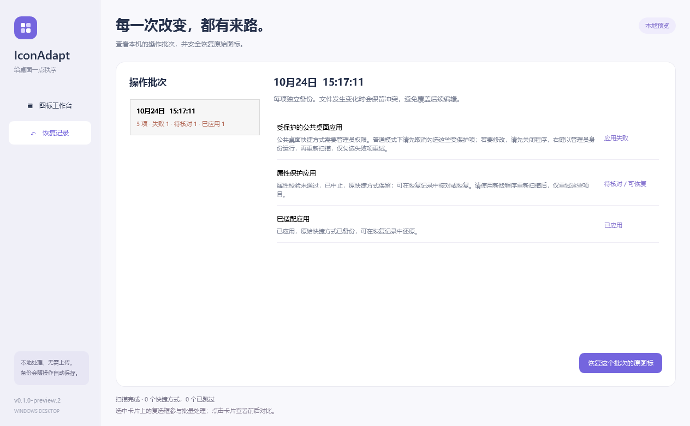

# 应用失败排查与解决方案

## 本次诊断

2026-10-24，用户反馈的两批操作均为 31 项：14 项已应用、13 项因权限失败、4 项被属性保护检查中止。诊断仅只读访问原始快捷方式与已有记录；重现写入使用隔离副本，不修改用户桌面、操作记录或 ACL。

### 公共桌面权限不足

13 项都位于系统公共桌面。当前进程未提升，文件 ACL 为普通交互用户提供读取和执行权限，没有修改文件内容的权限；文件本身不是只读属性。失败发生在应用前的写入权限检查，尚未生成快捷方式备份、也没有修改原文件。重复点击应用或刷新桌面无法补足权限。

处理步骤：

1. 关闭当前 IconAdapt 窗口，等待进行中的操作结束。
2. 右键新版 `IconAdapt.exe`，选择“以管理员身份运行”，由用户确认 UAC。
3. 尽量沿用同一 Windows 账户。若使用其他管理员账户，默认本地数据目录会变化，已有批次不会自动出现在另一个账户下。
4. 重新扫描，先清空选择，再只勾选权限失败项重试，避免给已成功的项目再增加适配批次。
5. 如果管理员运行后仍失败，检查该项是否只读、被其他程序占用或受更严格 ACL 限制，不把所有拒绝访问都归结为 UAC。

若不提升权限，则只处理当前账户可写的快捷方式。程序不自动提权，不修改公共桌面权限，也不自动移动或重建快捷方式。

### 相对路径标志误报

另 4 项在 Shell 保存临时快捷方式时触发保护检查。Windows 会规范化快捷方式的 `HasRelativePath` 结构标志；跨盘路径尤其容易触发。旧版误将这个结构位视作必须保持的启动行为位。

隔离比较发现启动目标、参数、工作目录、描述、窗口状态、快捷键与 PIDL 保持一致，仅图标相关标志及相对路径结构位改变。真实源文件 hash 仍等于原始 hash，说明保护检查发生在原子替换前，原文件未被改动。

`0.1.0-preview.2` 允许该结构位规范化，继续验证绝对启动目标、PIDL、参数、工作目录、窗口行为、快捷键和包括 RunAsUser 在内的其他行为标志。没有放宽所有属性检查。

使用新版重新扫描后，只选择这几项重试即可。旧版历史里的 pending 记录保留用于核对，不要删除整份数据目录，也不要为清理这些记录恢复包含已成功项目的整个批次。

## 结果怎么看

- `已应用`：已写入图标引用，桌面显示可能稍有延迟。
- `应用失败`：查看具体原因；权限失败不会靠刷新桌面解决。
- `待核对 / 可恢复`：保留了备份和意图记录，不能仅凭该状态断定原文件已修改。
- `文件已变化`：停止覆盖，先核对外部编辑或较新适配批次。

## 官方依据

- [Windows UAC 与访问令牌](https://learn.microsoft.com/en-us/windows/security/application-security/application-control/user-account-control/how-it-works)
- [MS-SHLLINK LinkFlags：结构与行为标志](https://learn.microsoft.com/en-us/openspecs/windows_protocols/ms-shllink/ae350202-3ba9-4790-9e9e-98935f4ee5af)
