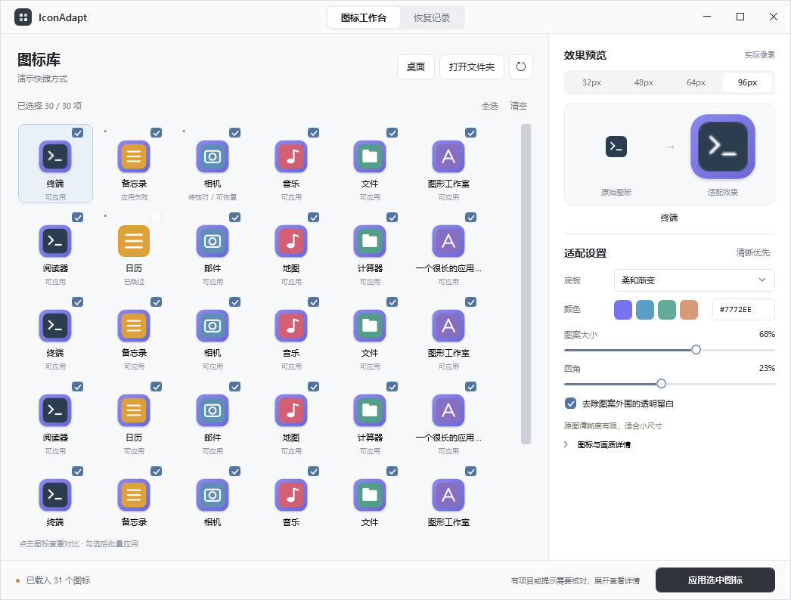

# 界面设计

## preview.4 的调整

桌面工具的主要内容是图标及其对比。旧布局的侧栏、大标题和大卡片占据了过多空间；在约 1046px 宽的窗口里只能看到两列图标，右侧设置需要滚动才能到达。

新版采用浅灰画布、白色面板、石墨色文字与主按钮，蓝色仅用于选中和焦点。顶部集中工作台 / 恢复记录导航，去掉侧栏和宣传标题。标题栏保留 Windows 的窗口操作习惯。

工作区使用紧凑图标网格，右侧检查器固定宽度。实际像素对比与基础设置保留在可见区域，补充诊断放入详情区。底部固定显示状态及应用 / 恢复按钮，长路径和完整诊断通过详情或工具提示查看。

## 图标和状态

- 网格显示 48 个物理像素；对比支持 32 / 48 / 64 / 96px，直接读取 ICO 内的对应帧，不通过放大图片填满卡片。
- 图标勾选表示将要应用的集合；当前焦点表示右侧正在查看的图标，两者独立。
- 成功与就绪使用中性色；原图尺寸限制属于画质提示；失败、冲突、待核对才使用问题提示。
- 保留错误原文与处理建议，简短状态不能替代诊断信息。

## 布局验收

最小窗口为 960 × 680，默认 1220 × 800。使用合成图标检查 960 × 680、1046 × 794 和 1280 × 820：基础设置、主操作、96px 对比不裁切；长标题省略；多图标可滚动；详情展开不挤走基础设置。恢复与空状态单独检查。

下图为 1046 × 794 的实际窗口，使用合成数据验证布局；选中的 32px 来源故意以 96px 输出，用于确认低清来源提示，不作为画质样板。

截图检查不能替代真实设备上的键盘、窗口拖动、多屏 DPI 和辅助功能体验验证。自动验证数据均为自建，不提交用户桌面图标或历史记录。
